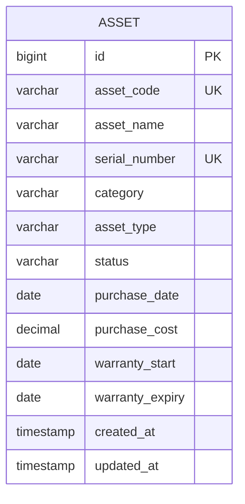

# Initial data model proposal

This is the minimum normalized foundation for the currently documented asset-register workflow. It is intentionally not a data model for all proposed modules. Confirm the model against the approved proposal before expanding it.

## Entities and relationships

- `asset` stores the durable asset record. Its optional descriptive category/type, department, location, and supplier fields remain text until controlled reference entities are approved.
- `asset.status` is constrained to the configurable workflow values documented in `docs/requirements/assumptions.md`.
- Asset code is required and unique. Serial number is nullable and unique when provided.
- A future assignment model should reference `asset` by foreign key and retain completed assignment events rather than overwrite movement history.

## Migration sequencing

This proposal precedes the initial Flyway migration. New reference entities and lifecycle tables should be introduced in additive migrations after requirements and relationships are reviewed.
